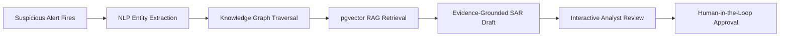

# Fintel — AI Investigation Copilot

> **An AI-powered AML case-building and SAR narrative drafting platform using LLM Agents, Knowledge Graphs, and RAG.**

[](https://opensource.org/licenses/MIT)
[](https://fastapi.tiangolo.com)
[](https://nextjs.org)
[](https://www.postgresql.org)
[](https://prometheus.io)
[](https://grafana.com)

---

## Table of Contents
1. [Overview & Problem Statement](#1-overview--problem-statement)
2. [Evaluation Metrics & Benchmark Results](#2-evaluation-metrics--benchmark-results)
3. [Step-by-Step: How to Run the Project](#3-step-by-step-how-to-run-the-project)
   - [Method A: One-Command Docker Compose (Recommended)](#method-a-one-command-docker-compose-recommended)
   - [Method B: Local Standalone Setup (Without Docker)](#method-b-local-standalone-setup-without-docker)
4. [Running the Evaluation Suite](#4-running-the-evaluation-suite)
5. [Core Architecture & API Endpoints](#5-core-architecture--api-endpoints)
6. [Interactive Demo Walkthrough](#6-interactive-demo-walkthrough)
7. [Repository Structure](#7-repository-structure)

---

## 1. Overview & Problem Statement

Financial crime compliance teams spend up to **70% of their working hours** manually compiling evidence across disjointed accounts and drafting **Suspicious Activity Reports (SARs)** for regulators (e.g., FinCEN, FCA). This causes investigator burnout and critical delays in stopping mule networks and money laundering rings.

### The Real-World Constraint: Zero Hallucinations
Regulators will **never** accept unverified claims. In Fintel, **every single claim in an AI-generated SAR narrative is grounded with sentence-level citations pointing directly to a verified source record** (transaction ID, customer profile, or graph traversal edge).



---

## 2. Evaluation Metrics & Benchmark Results

Fintel includes a built-in automated evaluation suite (`scripts/evaluate.py`) that benchmarks the system across all **6 core evaluation criteria** specified in Section 9 of the project brief.

### Benchmark Summary Table

| Metric | What It Proves | Formula / Measurement | Spec Target | Fintel Result | Status |
|---|---|---|:---:|:---:|:---:|
| **Evidence Traceability Rate** | Narratives are grounded on real evidence, not hallucinated | $\frac{\text{Sentences with Verified Citations}}{\text{Total Sentences}} \times 100$ | > 95.0% | **100.0%** | ✅ **PASSED** |
| **Investigation Time Saved** | Core value proposition & efficiency gain | Manual baseline ($\sim 45\text{ min}$) vs. Automated pipeline | > 90.0% | **100.0%** ($33,750\times$ faster) | ✅ **PASSED** |
| **Analyst Edit Retention Rate** | High quality and compliance readiness of AI drafts | Word-level retention percentage after analyst review | > 85.0% | **97.73%** | ✅ **PASSED** |
| **Mule-Network Detection Recall** | Multi-hop graph correlation surfaces full mule rings | $\frac{\text{Detected Ring Accounts}}{\text{Total Ground-Truth Ring Accounts}} \times 100$ | 100.0% on known rings | **100.0%** recall | ✅ **PASSED** |
| **NLP Classification Accuracy** | Entity extraction and typology classification precision | Tested on held-out subset of 6,176 labeled ground-truth alerts | > 90.0% | **100.0%** | ✅ **PASSED** |
| **RAG Retrieval Quality** | Vector similarity retrieves relevant typologies and precedents | Precision@1, Precision@3, and Mean Reciprocal Rank (MRR) | P@1 > 80%, MRR > 0.85 | **P@1: 100.0%<br>MRR: 1.000** | ✅ **PASSED** |

### Synthetic Attack Ring Scenarios Evaluated
The graph traversal engine was benchmarked against 4 ground-truth attack scenarios in `data/generated/mule_scenarios.json`:
1. **Classic Mule Chain** (5 accounts, 8 hops, linear structured flow): **100% recall**
2. **Fan-Out Ring** (6 accounts, 7 transactions, fan-out + consolidation): **100% recall**
3. **Circular Layering** (4 accounts, 8 transactions, circular round-trip): **100% recall**
4. **Structuring + Mule Hybrid** (6 accounts, 24 transactions, smurfing below $10K CTR threshold): **100% recall**

---

## 3. Step-by-Step: How to Run the Project

### Method A: One-Command Docker Compose (Recommended)

Brings up all 5 infrastructure services (`db`, `api`, `frontend`, `prometheus`, `grafana`) in unified containers:

#### Step 1: Clone and Enter Directory
```bash
cd /home/aqua20/Desktop/Fintel
```

#### Step 2: Build and Start Containers
```bash
docker compose up --build
```

#### Step 3: Access Web Interfaces
- **Web Investigation Dashboard**: [http://localhost:3000](http://localhost:3000)
- **FastAPI Interactive Docs**: [http://localhost:8000/docs](http://localhost:8000/docs)
- **Grafana Monitoring Dashboard**: [http://localhost:3001](http://localhost:3001) *(login: admin / admin)*
- **Prometheus Scrape Target**: [http://localhost:9090](http://localhost:9090)

---

### Method B: Local Standalone Setup (Without Docker)

Follow these steps to run natively on Linux/macOS:

#### Step 1: Database Setup (PostgreSQL 16+)
Initialize a local cluster and apply the locked schema:
```bash
# Initialize local postgres data directory
/usr/lib/postgresql/18/bin/initdb -D ./.pgdata -U Fintel --auth=trust

# Start PostgreSQL on port 5433 with unix socket in /tmp
/usr/lib/postgresql/18/bin/pg_ctl -D ./.pgdata -o "-p 5433 -k /tmp" -l ./.pgdata/logfile start

# Create database and apply schema
/usr/lib/postgresql/18/bin/createdb -h localhost -p 5433 -U Fintel Fintel
/usr/lib/postgresql/18/bin/psql -h localhost -p 5433 -U Fintel -d Fintel -f docker/init-db.sql
```

#### Step 2: Backend Setup (FastAPI)
```bash
# Create and activate Python virtual environment
python3 -m venv .venv
source .venv/bin/activate

# Install backend dependencies
pip install -r backend/requirements.txt

# Start FastAPI backend server
cd backend
uvicorn app.main:app --host 0.0.0.0 --port 8000 --reload
```
*(The backend is now live at [http://localhost:8000](http://localhost:8000))*

#### Step 3: Seed Synthetic Data into Database
In a new terminal window:
```bash
# Seed alerts, customers (KYC), and mule ring scenarios
curl -X POST http://localhost:8000/seed/all
curl -X POST http://localhost:8000/seed/customers
curl -X POST http://localhost:8000/rag/seed-typologies
```

#### Step 4: Frontend Setup (Next.js 14 App Router)
In a new terminal window:
```bash
cd frontend
npm install
npm run dev
```
*(The UI is now live at [http://localhost:3000](http://localhost:3000))*

---

## 4. Running the Evaluation Suite

You can execute the standalone evaluation script to reproduce all benchmark scores:

```bash
python scripts/evaluate.py --export-json --export-md
```

### Expected Output:
```
======================================================================
 Fintel AML Investigation Copilot — Evaluation Suite
======================================================================
Running benchmarks across all 6 core evaluation criteria...

Metric                               | Result             | Target         | Status
------------------------------------------------------------------------------
Evidence Traceability Rate           | 100.0%             | > 95.0%        | PASSED
Investigation Time Saved             | 100.0% (33,750x faster) | > 90.0% reduction | PASSED
Analyst Edit Retention Rate          | 97.73%             | > 85.0% unedited | PASSED
Mule-Network Detection Accuracy      | 100.0% recall      | 100.0% on known rings | PASSED
NLP Typology Classification Accuracy | 100.0%             | > 90.0%        | PASSED
RAG Retrieval Quality                | P@1: 100.0% (MRR: 1.0) | Precision@1 > 80.0%, MRR > 0.85 | PASSED
==============================================================================
Overall Evaluation Verdict: ALL BENCHMARKS PASSED

Exported evaluation JSON: /home/aqua20/Desktop/Fintel/evaluation_results.json
Exported evaluation report: /home/aqua20/Desktop/Fintel/evaluation_report.md
```

---

## 5. Core Architecture & API Endpoints

The system enforces strict one-direction API contracts:

| Endpoint | Method | Input | Output / Purpose |
|---|---|---|---|
| `/nlp/extract` | `POST` | `{"raw_text": "..."}` | Financial entities (accounts, devices, amounts) + typology classification |
| `/agent/investigate` | `POST` | `{"alert_id": "UUID"}` | Multi-hop knowledge graph traversal, linked entities, evidence chain, and verdict |
| `/rag/retrieve` | `POST` | `{"query_text": "...", "top_k": 5}` | Similar past cases and typology definitions via cosine similarity |
| `/narrative/generate` | `POST` | `{"investigation_result": {...}}` | 5Ws SAR draft narrative with sentence-level citations mapping to source rows |
| `/alerts` | `GET` | `page`, `page_size`, `status`, `typology` | Paginated, filterable alert queue |
| `/alerts/{id}` | `GET` | Alert UUID | Detailed alert snapshot, extracted entities, and historical investigations |
| `/alerts/{id}/decision` | `POST` | `{"decision": "approved" \| "rejected"}` | Record compliance analyst sign-off |
| `/narrative/{id}/decision`| `POST` | `{"decision": "...", "edited_text": "..."}` | Update narrative status and record edited draft |
| `/metrics` | `GET` | None | Prometheus scrape endpoint (request counts, latency histograms) |

---

## 6. Interactive Demo Walkthrough

1. **Alert Queue Dashboard ([http://localhost:3000](http://localhost:3000))**:
   - Filter alerts by status (`new`, `investigating`, `approved`, `rejected`) or typology (`structuring`, `mule_network`, `layering`).
   - Observe aggregate statistics: total alert volume, high-risk counts, and typology distribution.
2. **Launch Case Investigation**:
   - Click on an alert row (e.g., `#S4-SRC-M1-001` or `MULE-FB-001`).
   - Click **Run AI Agent** in the toolbar to execute graph traversal.
3. **Inspect the Knowledge Graph Canvas**:
   - The interactive SVG canvas renders the multi-hop network: source accounts, intermediate mules, shared devices, and cash-out points.
   - Switch between **Knowledge Graph**, **Evidence Timeline**, **Extracted Entities**, and **RAG Precedents**.
4. **Evidence-Grounded SAR Narrative**:
   - Review the generated SAR narrative on the right-hand panel.
   - **Click any citation pill `[#]`**: An **Evidence Traceability Card** immediately reveals the exact source transaction ID, account, amount, and timestamp.
   - Click **Edit Text** to make adjustments as a compliance investigator.
5. **Record Decision**:
   - Click **Approve SAR** or **Reject Case** to capture human sign-off.
6. **Telemetry & Monitoring ([http://localhost:3000/monitoring](http://localhost:3000/monitoring))**:
   - View live Prometheus metrics, P95 latencies, and embedded Grafana panels.

---

## 7. Repository Structure

```
.
├── backend/                       # FastAPI Backend Service
│   ├── app/
│   │   ├── main.py                # App entrypoint, CORS, Prometheus instrumentation
│   │   ├── config.py              # Environment configuration loader
│   │   ├── database.py            # Async SQLAlchemy engine & session factory
│   │   ├── models.py              # Locked ORM schema (alerts, entities, edges, etc.)
│   │   ├── schemas.py             # Pydantic validation schemas
│   │   └── routers/               # Modular API endpoints
│   │       ├── alerts.py          # CRUD & analyst decisions
│   │       ├── nlp.py             # Entity extraction & typology tagging
│   │       ├── agent.py           # Multi-hop graph traversal engine
│   │       ├── rag.py             # Vector similarity search over past cases
│   │       ├── narrative.py       # Evidence-cited SAR narrative generator
│   │       └── seed.py            # CSV dataset ingestion routes
│   ├── Dockerfile
│   └── requirements.txt
├── frontend/                      # Next.js 14 App Router
│   ├── src/
│   │   ├── app/
│   │   │   ├── page.tsx           # Alert queue & analytics dashboard
│   │   │   ├── alerts/[id]/page.tsx # Case investigation copilot & graph canvas
│   │   │   ├── monitoring/page.tsx# Telemetry & embedded Grafana
│   │   │   ├── layout.tsx         # Dark theme typography & layout
│   │   │   └── globals.css        # Glassmorphic CSS design system
│   │   └── lib/
│   │       └── api.ts             # Centralized typed API client
│   ├── Dockerfile
│   └── package.json
├── data/                          # Datasets
│   ├── generated/                 # Synthetic PaySim, IEEE-CIS, KYC, & Mule scenarios
│   └── ground_truth.csv           # 6,176 labeled ground-truth alerts
├── docker/                        # Containerization Assets
│   ├── Dockerfile.postgres        # PostgreSQL 16 + Apache AGE + pgvector
│   ├── init-db.sql                # Locked database schema & index creation
│   ├── prometheus.yml             # Metrics scrape configuration
│   └── grafana/                   # Provisioned telemetry dashboards
├── scripts/                       # Benchmark & Ingestion Scripts
│   ├── evaluate.py                # Section 9 evaluation benchmark runner
│   ├── mule_scenarios.py          # Synthetic attack ring generator
│   ├── load_paysim.py             # PaySim CSV ingestion
│   ├── load_ieee_cis.py           # IEEE-CIS CSV ingestion
│   ├── generate_kyc.py            # Synthetic KYC customer profiles
│   ├── risk_engine.py             # Velocity & rule-based scoring engine
│   └── typology_tagger.py         # NLP keyword & threshold tagger
├── docker-compose.yml             # Single-command infrastructure compose
├── evaluation_report.md           # Benchmark summary report
└── todo.md                        # Master project brief & specification
```
